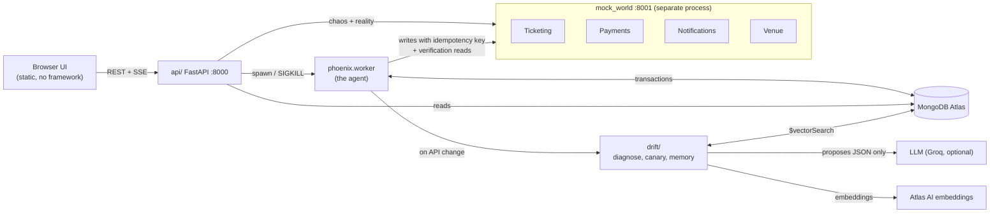
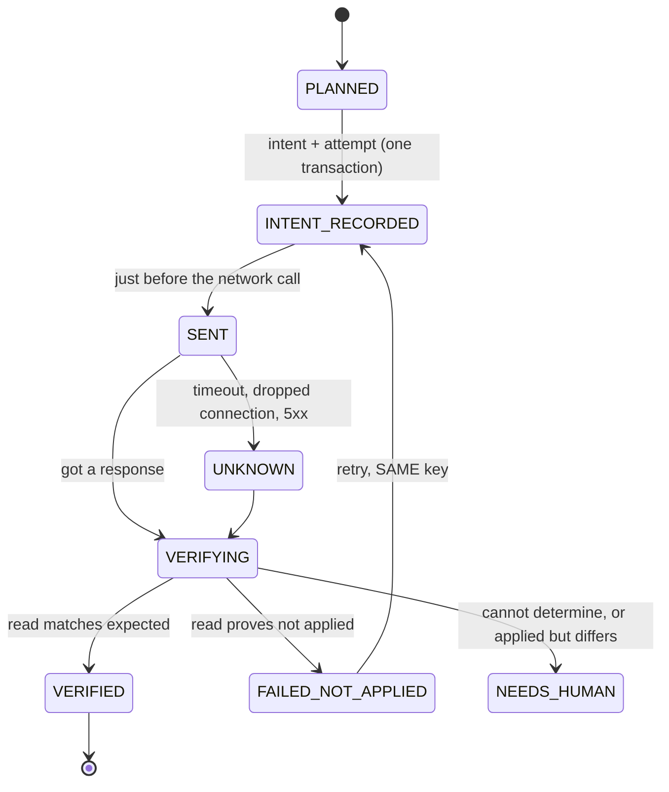

# Phoenix: an agent that finishes the job

> **MongoDB Agents in Context, Track 3: Finish the Job.**
> An agent that knows what **actually** happened across external systems, and finishes the job after crashes, timeouts, lost state and API changes, without ever paying anyone twice.

Real agent jobs span systems the agent does not control: payments, ticketing, email, a venue. Halfway through, the process dies, a request times out and nobody knows whether the refund happened, the agent's notes are gone, or an API changes shape overnight. A naive agent either stops or repeats a payment.

Phoenix never trusts its own memory. It writes down what it is about to do, does it with an idempotency key, then **asks the outside system what really happened** before counting anything as done. After a crash it asks the systems, not its notes.

## The three Track 3 questions

| Question | One-line answer |
|---|---|
| **What was supposed to happen?** | A deterministic plan of tasks, each with an expected effect and an idempotency key, persisted *before* any external call is made. |
| **What actually happened?** | Only what we read back from the real systems by that same key counts (`VERIFIED`); logs and our own records are never evidence. |
| **What is safe to do next?** | The recovery decision table: skip what is verified, retry with the same key what is proven not applied, and hand anything ambiguous or mismatched to a human. `explain` prints exactly this. |

## Demo scenario

An **event-cancellation agent**: cancel the event, refund every attendee, notify them, release the venue, and verify all of it.

- **The recorded demo cancels 8 attendees** (25 tasks): for each attendee `CANCEL_TICKET → REFUND → NOTIFY`, then one `RELEASE_VENUE` once every refund is verified. The event size is a setting (the *attendees* box next to *Reset*, up to 200, which is 601 tasks). We keep the demo small because each task takes about 2.5 s over Atlas (see Limitations).
- Four **mock external systems** (our own, in a separate process, `mock_world/`):
  - **Ticketing:** naturally idempotent.
  - **Payments:** idempotency keys and lookup by key.
  - **Notifications:** no idempotency, so verify before resend.
  - **Venue:** one-shot and not idempotent (a second cancel returns 409).
- **Chaos you can trigger from the UI**: lose a response *after* the write committed, fail before commit, add latency, switch the payments API to a new version (dollars `"85.00"` become cents `8500` plus a required `reason_code`), and edit a record behind the agent's back.

What the demo shows:

1. **Lost response, then `kill -9`.** A refund is applied but the reply is dropped; the agent is then killed mid-run. On restart it reads reality, resends nothing, and the final count is exact.
2. **Total memory loss.** The agent's records are wiped; *Reconcile* rebuilds the job purely from what the systems say.
3. **The API changes.** Every refund is rejected with a 422. The agent proposes a fix, **tests it with a dry run that moves no money**, and rejects a deliberately wrong fix (it would have refunded 85 cents instead of 85 dollars).
4. **It learns.** The working fix (and the failed one) is stored as a recovery memory. In the next run it is recalled with Vector Search, **and still re-tested** before use.

## Architecture



**The core is deterministic plain Python** (no workflow framework): a state machine, write-ahead intents, idempotency, external verification, resume and reconcile. **The LLM never executes anything.** It is only used to propose a declarative adaptation spec, which code validates and canary-tests before it is used. The plan itself is hard-coded.

### Task states



Any state can also escalate to `NEEDS_HUMAN`. Two recovery-only edges (`INTENT_RECORDED → VERIFYING`, `PLANNED → VERIFYING`) let a restarted agent or a reconcile check reality *before* resending. Full shapes are in [`contracts/CONTRACTS.md`](contracts/CONTRACTS.md).

**Recovery decision table** (applied on every restart, and after every send):

| Found | The external read says | Action |
|---|---|---|
| `INTENT_RECORDED`, `SENT` or `UNKNOWN` | applied, matches expected | mark `VERIFIED`, do not resend |
| `INTENT_RECORDED`, `SENT` or `UNKNOWN` | applied, differs from expected | `NEEDS_HUMAN` (never auto-correct money) |
| `INTENT_RECORDED`, `SENT` or `UNKNOWN` | not applied | retry with the same key |
| any | cannot determine | `NEEDS_HUMAN` |

### The seven invariants

| # | Invariant | Enforced in |
|---|---|---|
| 1 | Persist the intent (with its idempotency key) **before** any external call. | `phoenix/state.py` `record_intent` |
| 2 | Never retry a task in `SENT`/`UNKNOWN` without an external read first. | `phoenix/recover.py`, `phoenix/worker.py` |
| 3 | Only `VERIFIED` tasks count as progress. | transition table in `phoenix/models.py`; the API's counts |
| 4 | If an effect cannot be verified, go to `NEEDS_HUMAN`; never claim success. | `phoenix/verify.py`, `decide_next_state` |
| 5 | Applied but differs from expected means `NEEDS_HUMAN`; never auto-correct money. | `phoenix/recover.py` |
| 6 | State transition and its attempt/effect record are written in **one** Mongo transaction. | `phoenix/state.py`, `phoenix/db.py` |
| 7 | Adaptation specs are declarative (`rename`/`scale`/`add`/`remove` only), validated, and **always canary-verified** before the batch; recalled memories are never trusted without the canary. | `phoenix/drift/spec.py`, `phoenix/drift/canary.py` |

## How we use MongoDB Atlas

| Feature | Where | Why it matters here |
|---|---|---|
| **Multi-document transactions** | `phoenix/state.py` (`record_intent`, `record_result`, `resolve_verification`) | A task's state change and its attempt/effect record commit together or not at all (invariant 6). Needs an Atlas replica set. |
| **Unique indexes** | `tasks (run_id, seq)`, `tasks (run_id, idempotency_key)`, `attempts (task_id, attempt_no, phase)` | One task per item and one key per effect; an attempt can never be written twice. |
| **Compare-and-set updates** | `version` field plus a filtered `find_one_and_update` | A stale writer cannot move a task out of the state it was read in. |
| **Schema validation** | `$jsonSchema` on `tasks` and `attempts` (state enum, required fields) | Bad states are rejected by the database, not just by our code. |
| **Insert-only audit trail** | `attempts` (an `intent` and a `result` document per try) and `effects` (every external read: verify, reconcile, canary) | We can always show what we intended, what we sent, and what we observed. Insert-only by design; the code never updates them. |
| **Events collection as a narration stream** | `events` (ObjectId-ordered, plain-language messages) | The API serves it as Server-Sent Events with `Last-Event-ID` resume; the UI narrates from it. (It polls; we do not use Change Streams.) |
| **Atlas Vector Search** | `recovery_memories`, index `recovery_memories_vec` (1024-dim, cosine, filters on `system` and `polarity`) | Recalls a similar past API change. Embeddings come from Atlas's hosted Voyage endpoint (`voyage-4-lite`). Positive memories are candidates; negative ones block known-bad fixes. |
| **Idempotent setup** | `phoenix/db.py` (`init_db`), `scripts/reset.sh` | Indexes, validators and the vector index can be re-applied safely. |

Collections: `runs`, `tasks`, `attempts`, `effects`, `events`, `recovery_memories`.

## Quick start

**Prerequisites:** Python 3.11+, a MongoDB Atlas cluster (the free sandbox is enough; it must be a replica set for transactions). Optional: a Groq key (LLM) and an Atlas AI Model API key (embeddings). Without them it falls back to a built-in rule-based proposer and a local hashed embedding.

```bash
git clone https://github.com/janvipatel18902/phoenix-hackathon.git
cd phoenix-hackathon
python -m venv .venv && source .venv/bin/activate
pip install -r requirements.txt
cp .env.example .env        # then fill in MONGODB_URI (and the optional keys)
```

Run it, with three terminals from the repo root (venv active):

```bash
# 1. the fake outside world
uvicorn mock_world.app:app --port 8001

# 2. reseed the world, clear the app's collections, create the vector index
scripts/reset.sh

# 3. the API, which also serves the UI and starts/kills the agent
uvicorn api.main:app --port 8000
```

Open **http://localhost:8000**. In the box next to *Reset*, set **8** attendees and click **Reset**, then **Cancel the event**. Try **Lose next refund response**, **Kill -9 the agent**, **Wipe agent memory**, and **Payments API changes (v2)** (tick *"first proposed API fix is wrong"* to see the canary catch a bad fix).

> `scripts/reset.sh` and the UI's *Reset* clear the runs, tasks, attempts, effects and events in whatever database `MONGODB_DB` points to. Use a scratch database. Variables already set in your shell take precedence over `.env`.
>
> On macOS with the python.org Python, if Atlas fails with `CERTIFICATE_VERIFY_FAILED`, set `SSL_CERT_FILE=$(python -c "import certifi;print(certifi.where())")`.

Each task needs about 25 round trips to Atlas, so over a 100 ms link a task takes about 2.5 s; 8 to 20 attendees keeps a demo run to one to three minutes.

**Tests** (no Atlas needed; they use mongomock and an in-process mock world):

```bash
pytest -q tests mock_world api phoenix/drift     # 101 tests
ruff check .
```

The agent can also be run by hand: create a run with `POST /runs`, then `python -m phoenix.worker`. Crash points can be injected with `PHOENIX_CRASH_AT=after_response:5` (see [`contracts/CONTRACTS.md`](contracts/CONTRACTS.md), section 8).

### Repository layout

```
contracts/CONTRACTS.md   source of truth: document shapes, states, endpoints, events
phoenix/                 the engine (deterministic core)
  db.py models.py state.py intents.py verify.py recover.py reconcile.py explain.py worker.py
  drift/                 spec.py diagnose.py canary.py memory.py   (adapting to API changes)
mock_world/              the four fake systems plus chaos and admin endpoints
api/                     FastAPI: REST, SSE, agent control, chaos proxy; serves the UI
ui/                      index.html app.js style.css (static; no framework, no CDN)
scripts/                 reset.sh, reset_db.py
tests/                   engine tests; more tests live beside mock_world/, api/, phoenix/drift/
```

## What was built during the hackathon

**Everything in this repository was written during the event, on 2026-11-14, by the two of us** (first commit 11:20 ET, the last of this version at 15:38 ET). We used no template, boilerplate or code from earlier projects. The only external code is the third-party libraries and services listed below.

**Who built what**

| Person | Built |
|---|---|
| **Janvi Patel** ([@janvipatel18902](https://github.com/janvipatel18902)) | The engine in `phoenix/` (everything outside `drift/`): the task state machine and its transition rules, write-ahead intents and idempotency keys, external verification, the recovery decision table, reconcile, `explain`, the worker (heartbeat, crash injection), the database layer (schema validation, indexes, transactions), and the unit tests in `tests/`. Also wired the drift hook into the worker and polished the UI (captions and tooltips, the redesign, the "Forget learned fixes" button). |
| **[@ravinkaur1997](https://github.com/ravinkaur1997)** | The mock world (four systems, chaos, dry-run mode, persistence), the API (REST, SSE, agent start/kill, wipe and reconcile), the first version of the UI (grid, belief-vs-reality, narration feed, self-healing strip), the drift package (spec validator, diagnosis, canary, recovery memories with Vector Search), `scripts/`, and the API, mock-world and drift tests plus the engine-versus-mock integration tests. |
| **Both** | [`contracts/CONTRACTS.md`](contracts/CONTRACTS.md), the shared source of truth for shapes, which each of us edited before changing code. |

**Third-party tools and services we use**

- **MongoDB Atlas** (sandbox cluster) with **Atlas Vector Search**.
- **Atlas AI Model API**, the hosted Voyage AI endpoint, for embeddings (`voyage-4-lite`).
- **Groq API** for the optional LLM that proposes adaptation specs (the model is configurable via `GROQ_MODEL`).
- **Python libraries:** FastAPI, Uvicorn, Pydantic, PyMongo, HTTPX, python-dotenv.
- **Test and dev tooling:** pytest, pytest-asyncio, respx, mongomock, ruff.
- The UI uses **no** front-end libraries.

**AI-assisted development:** we used an AI coding assistant (Claude Code by Anthropic) while writing the code; this shows as co-author lines in the commit history. Design decisions, the invariants and the verification were ours. At runtime the LLM only proposes JSON, and code validates and tests it.

## Status and limitations

**What works and was verified**

- 101 automated tests pass, including the real worker run against the real mock world with the full 200-attendee event (601 tasks): a clean run, chaos, crash-state resume, an API change with a wrong first fix, and memory reuse in a second run.
- Verified live against Atlas with a real worker process, on **20-attendee events** (61 tasks, not the full 200): `kill -9` and resume with lost responses and failures; a crash after a refund was applied but before it was recorded (no resend); wipe then reconcile; payments switched to v2 with the canary rejecting a wrong fix; and a second run reusing the memory through Vector Search. In those runs there were no duplicate refunds.

**Limitations (please read)**

- **The outside systems are mocks.** They imitate idempotency, one-shot and lossy behaviour but are not real payment or email providers.
- **Demo scale.** The recorded demo uses 8 attendees, not 200. Many round trips per task means a full 200-attendee run would take about 25 minutes over our Atlas connection (about 100 ms per round trip), and **we did not run the full 200-attendee event live against Atlas**; at that size it was only run in-process against the mock world.
- **Adaptation is narrow.** Drift handling covers payments `create_refund` when the API rejects with a `422 validation_error` and lists unknown or missing fields, using only four declarative operations. Anything else becomes `NEEDS_HUMAN`.
- **The LLM is optional and unreliable by nature.** The free Groq tier can rate-limit, in which case a deterministic rule-based proposer takes over (the narration says so). The local fallback embedding is lexical, not semantic. The "wrong first fix" is a demo switch (`PHOENIX_DEMO_WRONG_FIRST`), not an LLM mistake.
- **Not implemented:** an LLM that parses the instruction into a plan (the plan is hard-coded); detection of the `mutate_record` chaos (the agent stores a record version per task but does not yet compare it to the live record); an `explain` command-line entry point (it is available through the API and the UI); and any way to resolve a `NEEDS_HUMAN` task from the UI. That state cannot be triggered from the UI either.
- **Atomicity is only exercised on Atlas.** The unit tests use mongomock, which has no transactions, so invariant 6 is verified by the live Atlas runs and not by the unit tests.
- **Demo-grade operations.** One worker runs one task at a time, there is a single event, and the API has no authentication and is meant for localhost.
- **The UI is a demo surface**, not a dashboard: it has no charts or analytics, only the grid, the belief-versus-reality panel, the narration feed, the chaos controls and a short "what it has learned" panel.
